# DevSphere
### A Developer Community & Knowledge Sharing Platform

**Built with curiosity. Designed for developers.**

DevSphere is a full-stack developer community platform where developers can share knowledge, publish technical articles, explore programming content, connect with other developers, and get AI-powered assistance.

This project was built over **3 months**, with a focus on understanding the technologies behind each feature and applying them to solve real development problems — not just making things work, but understanding how and why they work.

 **Live Application:** https://devsphere-app.netlify.app/

 **Frontend Repository:** https://github.com/awanayaan97-maker/DevSphere-Frontend

 **Backend Repository:** https://github.com/awanayaan97-maker/DevSphere-Backend-

---

## Explore DevSphere

A look at the platform and its core experiences.

### Home Feed
Discover developer content, explore posts, and stay connected with the community.

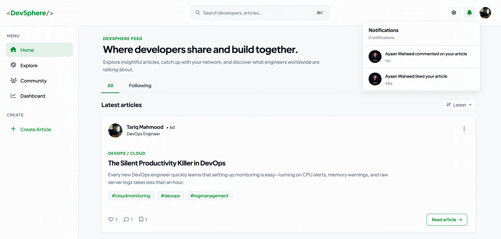

### Search Experience
Find relevant content through the platform's search functionality.

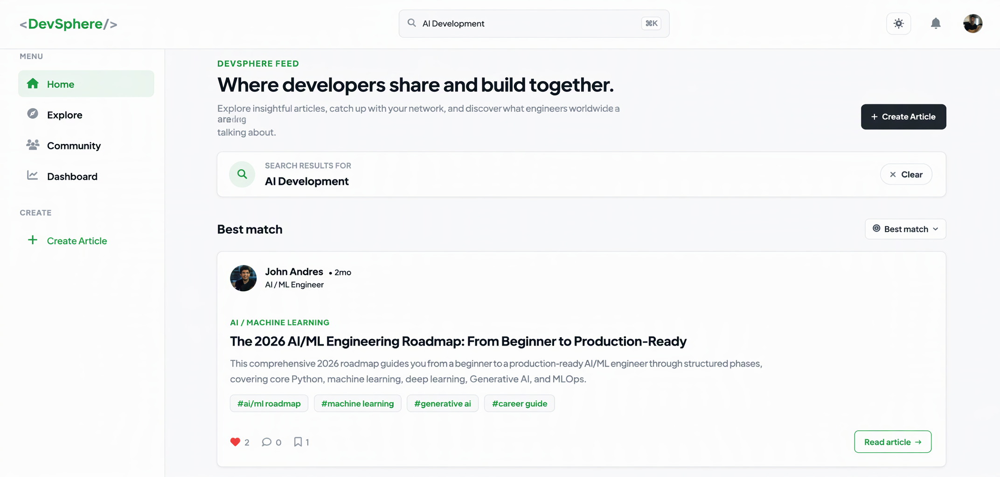

### Explore
Explore trending categories, discover publishers, and find content based on your interests.

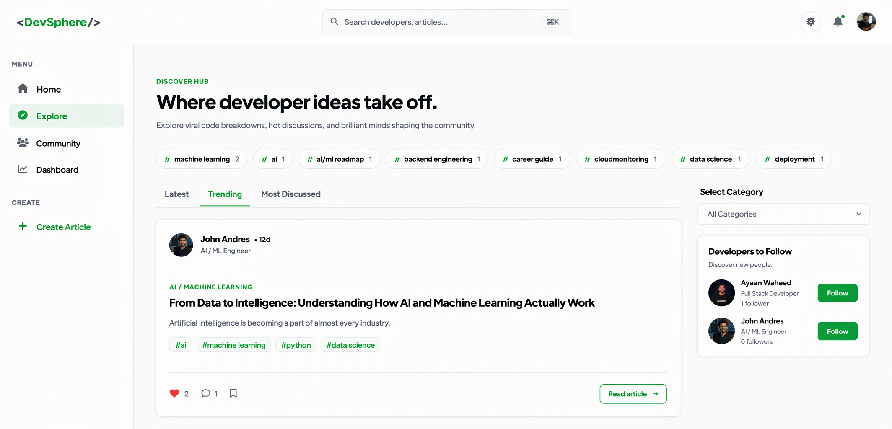

### Developer Community
Share ideas, discuss technical topics, and interact with other developers through posts, comments, replies, and code snippets.

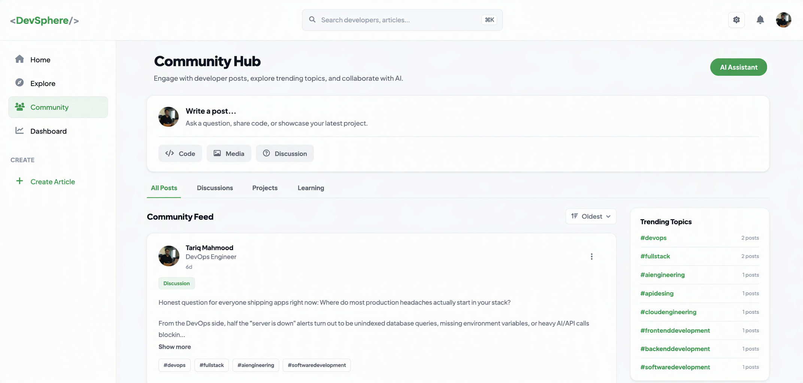

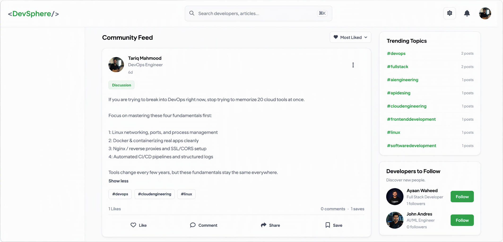

### Personal Dashboard
Keep track of your published articles, drafts, posts, followers, and top-performing content through dashboard insights and visual charts.

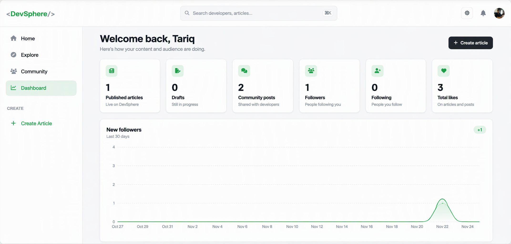

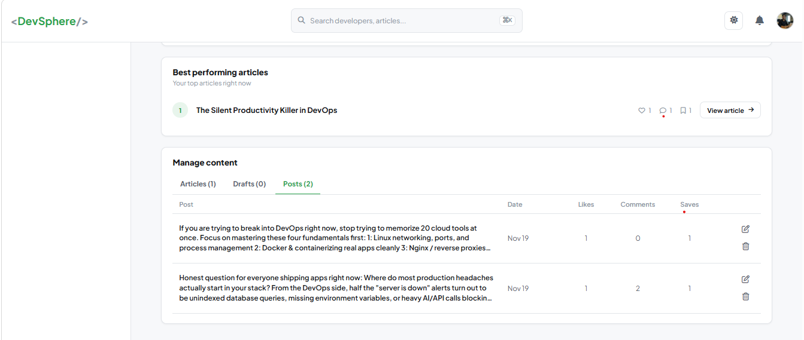

### AI-Powered Assistance

DevSphere offers two different AI experiences:

- **Community AI Assistant:** A general-purpose programming assistant with Ask, Explain, Debug, and Review modes.
- **Article AI Assistant:** An article-aware assistant that uses the current article's content to answer questions and help readers understand it.

#### Community AI Assistant

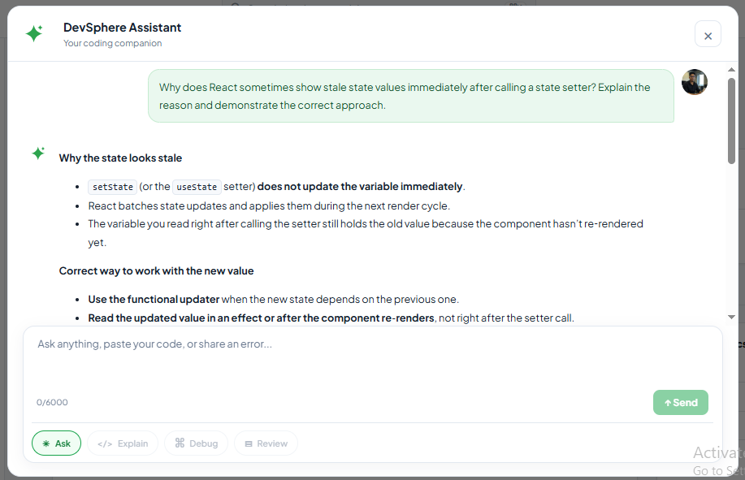

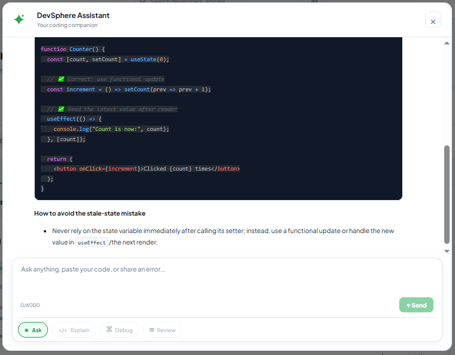

#### Article AI Assistant

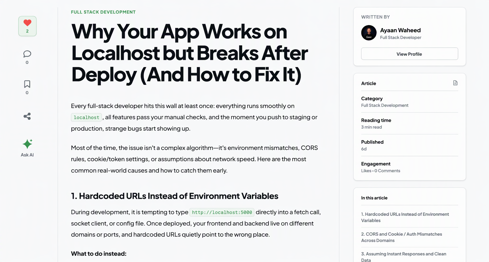

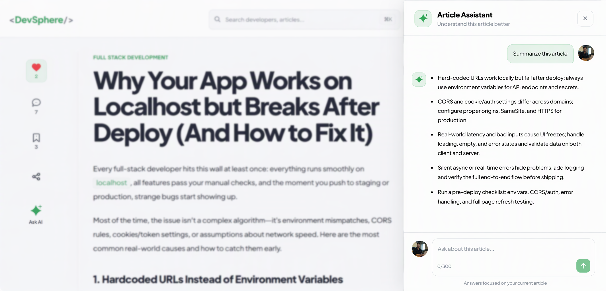

---

## Key Features

### Authentication & Account Security
- Email OTP verification.
- OTP resend functionality.
- Google authentication.
- Secure login and signup.
- Password reset functionality.

### Articles & Knowledge Sharing
- Create, edit, delete, and publish articles.
- Save articles as drafts and publish them later.
- Rich text editing with Tiptap.
- Support for images and tables inside articles.
- Search and sort articles.
- All Articles and Following feeds.
- Like, bookmark, comment, reply, and share articles.
- Article-specific AI assistance.

### Developer Community
- Create posts with images and code snippets.
- Select programming languages for code snippets.
- Syntax highlighting with CodeMirror.
- Like, comment, reply, and interact with comments.
- Share and save posts.
- General-purpose AI programming assistance.

### Explore & Discover
- Discover trending categories.
- Explore publishers and their content.
- Follow publishers.
- Discover content through sorting and search.

### Dashboard & Analytics
- Track published articles and drafts.
- View top articles and community posts.
- Monitor followers.
- Visualize platform activity through charts.
- Manage and delete your articles and posts.

### Real-Time Notifications
- Real-time notifications using Socket.IO.
- TanStack Query integration for client-side data and cache updates.

---

## Technology Stack

| Category | Technologies |
|---|---|
| Frontend | React, Vite, JavaScript |
| Styling | CSS |
| Routing | React Router |
| State Management | Context API |
| Data Fetching & Caching | TanStack Query |
| Real-Time Communication | Socket.IO Client |
| Rich Text Editor | Tiptap |
| Code Editor | CodeMirror |
| Charts | Recharts |
| Authentication | Google OAuth |
| API Communication | Fetch API |

---

## Getting Started

Follow these steps to run the frontend locally.

### Prerequisites

Make sure you have installed:

- Node.js
- npm
- Git

The backend must also be running for API-dependent features to work.

### 1. Clone the Repository

```bash
git clone https://github.com/awanayaan97-maker/DevSphere-Frontend.git
```

### 2. Navigate to the Project

```bash
cd DevSphere-Frontend
```

### 3. Install Dependencies

```bash
npm install
```

### 4. Configure Environment Variables

Create a `.env` file in the root directory and add:

```env
VITE_API_URL=http://localhost:3000
VITE_GOOGLE_CLIENT_ID=your_google_client_id
```

Replace the values with your local backend URL and Google OAuth Client ID.

### 5. Start the Development Server

```bash
npm run dev
```

Open the local URL provided by Vite in your browser.

---

## Deployment

| Service | Platform |
|---|---|
| Frontend | Netlify |
| Backend | Vercel |
| Database | MongoDB |

**Live Application:** https://devsphere-app.netlify.app/

---

## License

This project is licensed under the **MIT License**.

You are free to use, modify, and distribute this project under the terms of the MIT License. See the [LICENSE](./LICENSE) file for details.

---

## About the Developer

**Ayaan Waheed**

DevSphere represents a practical learning and development journey — from understanding individual technologies to bringing them together into a deployed full-stack application.

The goal was not simply to build another CRUD application, but to explore how different parts of a developer platform work together: authentication, content management, real-time communication, AI integration, and a responsive user experience.

If you find the project interesting, feel free to explore the repositories!

- GitHub: https://github.com/awanayaan97-maker